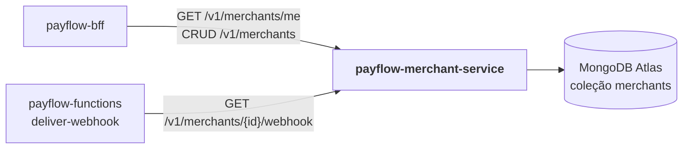

# payflow-merchant-service

**Microsserviço 1 do PayFlow — domínio de Lojistas**, persistido no **MongoDB Atlas**.

Parte da plataforma PayFlow (arc42 completo no repositório de documentação
[`PayFlow`](https://github.com/CaioSeniuk/PayFlow)). Alunos: **Caio Henrique,
Gabriel Moribe, Guilherme Celente e Leonardo Berlanda** — PUCPR, Arquitetura de
Soluções com Cloud, 2026.

## O que é este repositório

Serviço dono dos dados de **lojistas**: cadastro (CRUD completo), chave de acesso
(API key do lojista, armazenada só como hash SHA-256) e **configuração de webhook**.
É consultado pelo BFF para autenticar o lojista e montar o painel, e pela Azure
Function `deliver-webhook` para saber para onde enviar as notificações.

Requisito da atividade atendido: _"Microserviço 1 (MongoDB) — MongoDB Atlas (Free
Tier), responsável por um domínio, CRUD completo, Swagger documentado"_.

## Relação com os outros repositórios



| Repositório | Relação |
|---|---|
| `payflow-bff` | Consumidor principal: autentica o lojista (`/me`), compõe `/aggregated-data` e faz proxy do CRUD. |
| `payflow-functions` | `deliver-webhook` lê URL, segredo e eventos do webhook do lojista. |
| `payflow-payment-service` | Nenhuma chamada direta; guarda apenas `merchantId` como referência lógica. |
| `payflow-frontend` | Nenhuma chamada direta (passa sempre por API Gateway → BFF). |

## Tecnologias

| Item | Escolha |
|---|---|
| Linguagem / framework | Java 21, Spring Boot 4 (Web MVC, Validation, Actuator) |
| Banco | MongoDB Atlas M0 (Spring Data MongoDB) |
| Documentação | springdoc-openapi (`/swagger-ui.html`, `/v3/api-docs`) |
| Testes | JUnit 5, ArchUnit (arquitetura), Testcontainers MongoDB (integração), MockMvc |
| Contêiner | Dockerfile multi-stage (JDK → JRE, usuário não root) |
| Registro | Docker Hub: `docker.io/<dockerhub-user>/payflow-merchant-service:<tag>` |
| Execução na nuvem | Azure Container Apps (`ca-payflow-merchant`) |

## Arquitetura interna (Clean Architecture + Vertical Slice)

| Camada | Pacote | Conteúdo |
|---|---|---|
| Domain | `domain/` | `Merchant`, `ApiKey`, `WebhookSubscription`, `MerchantStatus`, porta `ApiKeyHasher` — Java puro |
| Application | `features/<fatia>/` | `*Handler` (caso de uso), `*Command`/`*Result`, portas de saída da fatia |
| API | `features/<fatia>/*Endpoint` | Controller REST da fatia |
| Infrastructure | `infrastructure/` | `mongodb/` (documento, mapper, store), `crypto/` (SHA-256), `web/` (filtro `X-Internal-Key`, Problem Details), `config/` |

Estrutura-alvo:

```text
src/main/java/br/com/payflow/merchant/
├── domain/
├── features/
│   ├── createmerchant/        POST   /v1/merchants
│   ├── listmerchants/         GET    /v1/merchants
│   ├── getmerchant/           GET    /v1/merchants/{id}
│   ├── updatemerchant/        PUT    /v1/merchants/{id}
│   ├── deletemerchant/        DELETE /v1/merchants/{id}
│   ├── authenticate/          GET    /v1/merchants/me            (já existe)
│   ├── configurewebhook/      PUT    /v1/merchants/{id}/webhook
│   ├── getwebhook/            GET    /v1/merchants/{id}/webhook  (uso interno)
│   ├── rotateapikey/          POST   /v1/merchants/{id}/api-key
│   └── provision/             lojista demo no startup             (já existe)
└── infrastructure/
```

Regras verificadas por `ArchitectureTests` (ArchUnit): `domain` não importa
Spring/Mongo/Jakarta; uma fatia não importa outra; fatias não importam
`infrastructure`.

## Endpoints previstos

| Método | Rota | Descrição | Autenticação |
|---|---|---|---|
| POST | `/v1/merchants` | Cria lojista; devolve a API key **uma única vez** | `X-Internal-Key` |
| GET | `/v1/merchants` | Lista (paginada, filtro por status) | `X-Internal-Key` |
| GET | `/v1/merchants/{id}` | Detalha | `X-Internal-Key` |
| PUT | `/v1/merchants/{id}` | Altera nome, e-mail, status | `X-Internal-Key` |
| DELETE | `/v1/merchants/{id}` | Remove | `X-Internal-Key` |
| GET | `/v1/merchants/me` | Lojista dono da chave | `X-Merchant-Key` |
| PUT | `/v1/merchants/{id}/webhook` | Define URL, segredo e eventos | `X-Internal-Key` |
| GET | `/v1/merchants/{id}/webhook` | Configuração completa (para a Function) | `X-Internal-Key` |
| POST | `/v1/merchants/{id}/api-key` | Rotaciona a chave | `X-Internal-Key` |
| GET | `/actuator/health` | Health check (Container Apps probes) | — |
| GET | `/swagger-ui.html` | Swagger | — |

Erros no formato Problem Details (RFC 9457).

## Modelo de dados (coleção `merchants`)

```json
{
  "_id": "UUID",
  "name": "Loja Exemplo",
  "email": "contato@loja.com",
  "document": "12345678000190",
  "apiKeyHash": "sha256…",
  "status": "ACTIVE",
  "webhook": { "url": "https://…", "secret": "…", "events": ["payment.authorized"] },
  "createdAt": "…",
  "updatedAt": "…"
}
```

Índices únicos: `apiKeyHash`, `document`.

## Estado atual

Já implementado (código trazido do antigo `payment-api/` do monorepo, com histórico):

- [x] Conexão ao MongoDB Atlas e índice único de `apiKeyHash`
- [x] Fatia `provision` (lojista demo no startup)
- [x] Fatia `authenticate` (`GET /v1/merchants/me`, hoje com cabeçalho `X-Api-Key`)
- [x] ArchUnit, testes unitários e de integração (Testcontainers)
- [x] Dockerfile e `compose.yaml`

A fazer:

- [ ] Renomear `payment-api` → `merchant-service` (artifactId, pacote `br.com.payflow.merchant`, classe principal, `spring.application.name`, JAR no Dockerfile)
- [ ] Renomear o cabeçalho do lojista `X-Api-Key` → `X-Merchant-Key` (o API Gateway usa `x-api-key`)
- [ ] Mover as fatias para `features/` e criar as fatias CRUD, webhook e rotação de chave
- [ ] Filtro `X-Internal-Key` para rotas internas
- [ ] springdoc-openapi
- [ ] Testes unitários de cada fatia nova
- [ ] Publicar `v1` no Docker Hub e implantar no Container Apps
- [ ] GitHub Actions: build + testes + push da imagem em tags `v*`

## Como rodar localmente

Pré-requisitos: Docker com Compose v2 (ou JDK 21 para rodar sem Docker).

```bash
cp .env.example .env      # preencha MONGODB_URI e DEMO_MERCHANT_API_KEY
docker compose --env-file .env up -d --build
curl http://localhost:8080/actuator/health
```

Sem Docker:

```bash
./mvnw spring-boot:run -Dspring-boot.run.profiles=local   # lê o .env desta pasta
```

Testes (requer Docker para o Testcontainers):

```bash
./mvnw verify
```

### Variáveis de ambiente

| Variável | Descrição |
|---|---|
| `MONGODB_URI` | URI `mongodb+srv://` do Atlas (segredo) |
| `MONGODB_DATABASE` | Banco; padrão `payflow` |
| `PAYFLOW_DEMO_MERCHANT_ENABLED` / `DEMO_MERCHANT_API_KEY` | Lojista demo (32–256 caracteres) |
| `PAYFLOW_INTERNAL_KEY` | Chave compartilhada com BFF e Function (_a criar_) |
| `PORT` | Porta HTTP; padrão `8080` |

### Preparar o MongoDB Atlas

1. Cluster M0; usuário de banco com `readWrite` apenas no banco `payflow`.
2. Network Access: IP local para desenvolvimento e IPs de saída do Container Apps Environment para a nuvem.
3. Copie a URI de *Connect → Drivers* para `MONGODB_URI` (senha percent-encoded).

## Publicação

```bash
docker buildx build --platform linux/amd64 \
  -t docker.io/<dockerhub-user>/payflow-merchant-service:v1 --push .
```

Azure Container Apps: ingress externo na porta 8080, secrets `mongodb-uri` e
`internal-key`, probes em `/actuator/health/liveness` e `/actuator/health/readiness`.

## Links

| Item | URL |
|---|---|
| Swagger (nuvem) | _a publicar_ |
| Docker Hub | _a publicar_ |
| Documentação de arquitetura | https://github.com/CaioSeniuk/PayFlow |
