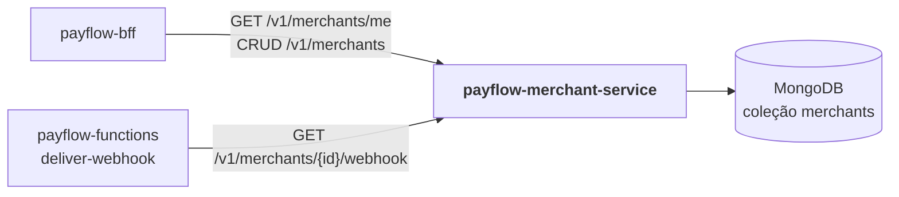

# payflow-merchant-service

**Microsserviço 1 do PayFlow — domínio de Lojistas**, persistido no **MongoDB Atlas**
(MongoDB local em desenvolvimento).

Parte da plataforma PayFlow (arc42 completo no repositório de documentação
[`PayFlow`](https://github.com/CaioSeniuk/PayFlow)). Alunos: **Caio Henrique,
Gabriel Moribe, Guilherme Celente e Leonardo Berlanda** — PUCPR, Arquitetura de
Soluções com Cloud, 2026.

## O que é este repositório

Serviço dono dos dados de **lojistas**: cadastro (CRUD completo), chave de acesso
(API key do lojista, armazenada só como hash SHA-256) e **configuração de webhook**.
É consultado pelo BFF para autenticar o lojista e montar o painel, e pela Azure
Function `deliver-webhook` para saber para onde enviar as notificações.

Requisito da atividade atendido: _"Microserviço 1 (MongoDB) — MongoDB Atlas (Free
Tier), responsável por um domínio, CRUD completo, Swagger documentado"_.

## Relação com os outros repositórios



| Repositório | Relação |
|---|---|
| `payflow-bff` | Consumidor principal: autentica o lojista (`/me`), compõe `/aggregated-data` e faz proxy do CRUD. |
| `payflow-functions` | `deliver-webhook` lê URL, segredo e eventos do webhook do lojista. |
| `payflow-payment-service` | Nenhuma chamada direta; guarda apenas `merchantId` como referência lógica. |
| `payflow-frontend` | Nenhuma chamada direta (passa sempre por API Gateway → BFF). |

## Tecnologias

| Item | Escolha |
|---|---|
| Linguagem / framework | Java 21, Spring Boot 4.0 (Web MVC, Validation, Actuator) |
| Banco | MongoDB 8 local (Docker) ou MongoDB Atlas M0, via Spring Data MongoDB |
| Documentação | springdoc-openapi 3 (`/swagger-ui.html`, `/v3/api-docs`) |
| Testes | JUnit 5, AssertJ, ArchUnit (arquitetura), Testcontainers MongoDB (integração) |
| Contêiner | Dockerfile multi-stage (JDK → JRE, usuário não root) e `compose.yaml` com MongoDB |
| CI | GitHub Actions: testes em todo push; imagem no Docker Hub em tags `v*` |
| Execução na nuvem | Azure Container Apps (`ca-payflow-merchant`) |

## Arquitetura interna (Clean Architecture + Vertical Slice)

| Camada | Pacote | Conteúdo |
|---|---|---|
| Domain | `domain/` | `Merchant`, `MerchantStatus`, `WebhookSubscription`, `WebhookEvent`, `ApiKey`, portas `ApiKeyHasher` e `CredentialGenerator` — Java puro |
| Application | `features/<fatia>/` | `*Handler` (caso de uso), `*Command`/resultado, porta de saída própria da fatia |
| API | `features/<fatia>/*Endpoint`, `api/` | Controller REST da fatia; `api/` tem a representação pública comum (`MerchantResponse`) e os nomes dos cabeçalhos |
| Infrastructure | `infrastructure/` | `mongodb/` (documento, mapper, store, índices), `crypto/` (SHA-256, gerador de chaves), `web/` (filtro `X-Internal-Key`, Problem Details, Swagger) |

```text
src/main/java/br/com/payflow/merchant/
├── domain/
├── api/                          MerchantResponse, ApiSecurity
├── features/
│   ├── createmerchant/        POST   /v1/merchants
│   ├── listmerchants/         GET    /v1/merchants
│   ├── getmerchant/           GET    /v1/merchants/{id}
│   ├── updatemerchant/        PUT    /v1/merchants/{id}
│   ├── deletemerchant/        DELETE /v1/merchants/{id}
│   ├── authenticate/          GET    /v1/merchants/me
│   ├── configurewebhook/      PUT    /v1/merchants/{id}/webhook
│   ├── getwebhook/            GET    /v1/merchants/{id}/webhook
│   ├── rotateapikey/          POST   /v1/merchants/{id}/api-key
│   └── provision/             lojista demo no startup
└── infrastructure/
```

Regras verificadas por `ArchitectureTests` (ArchUnit) a cada `./mvnw verify`:

1. `domain` não importa Spring, Mongo, Jakarta, Swagger nem Jackson, nem as outras camadas.
2. Uma fatia não importa outra.
3. Handlers, comandos e portas não importam framework (só `*Endpoint`, `*Slice` e `*Properties` conhecem o Spring).
4. Fatias não importam `infrastructure`; o `MongoMerchantStore` implementa a porta de cada fatia.
5. `api/` só é usado por `*Endpoint` e pela infraestrutura web.

## Endpoints

| Método | Rota | Descrição | Autenticação |
|---|---|---|---|
| POST | `/v1/merchants` | Cria lojista; devolve a API key **uma única vez** (201 + `Location`) | `X-Internal-Key` |
| GET | `/v1/merchants?status=&page=0&size=20` | Lista paginada, mais recentes primeiro (`size` até 100) | `X-Internal-Key` |
| GET | `/v1/merchants/{id}` | Detalha | `X-Internal-Key` |
| PUT | `/v1/merchants/{id}` | Altera nome, e-mail e status (`ACTIVE`/`SUSPENDED`) | `X-Internal-Key` |
| DELETE | `/v1/merchants/{id}` | Remove (204) | `X-Internal-Key` |
| GET | `/v1/merchants/me` | Lojista dono da chave; lojista suspenso recebe 401 | `X-Merchant-Key` |
| PUT | `/v1/merchants/{id}/webhook` | Define URL, segredo e eventos; sem segredo, gera um e devolve | `X-Internal-Key` |
| GET | `/v1/merchants/{id}/webhook` | Configuração completa, com segredo (para a Function) | `X-Internal-Key` |
| POST | `/v1/merchants/{id}/api-key` | Gera nova chave; a anterior para de funcionar na hora | `X-Internal-Key` |
| GET | `/actuator/health` | Health check (`/liveness` e `/readiness` com probes ligados) | — |
| GET | `/swagger-ui.html` | Swagger UI (botão *Authorize* para as duas chaves) | — |

Erros no formato Problem Details (RFC 9457): 400 para dados inválidos (com o motivo em
`detail`), 401 para chave ausente ou inválida, 404 para lojista inexistente ou webhook
não configurado, 409 para documento já cadastrado.

Eventos aceitos no webhook: `payment.authorized`, `payment.declined`, `payment.pending`,
`payment.confirmed`, `payment.refunded`, `payment.canceled`. A URL pode ser `http` ou
`https` (o `http` existe para receptores locais durante o desenvolvimento).

Respostas de lojista nunca trazem `apiKeyHash` nem o segredo do webhook:

```json
{
  "id": "00000000-0000-0000-0000-000000000001",
  "name": "Demo Merchant",
  "email": "demo@payflow.local",
  "document": "11222333000181",
  "status": "ACTIVE",
  "webhookConfigured": true,
  "webhook": { "url": "https://loja.example/hooks", "events": ["payment.authorized"] },
  "createdAt": "2026-10-26T19:00:24.626Z",
  "updatedAt": "2026-10-26T19:05:10.120Z"
}
```

## Modelo de dados (coleção `merchants`)

```json
{
  "_id": "UUID",
  "name": "Loja Exemplo",
  "email": "contato@loja.com",
  "document": "12345678000190",
  "apiKeyHash": "sha256…",
  "status": "ACTIVE",
  "webhook": { "url": "https://…", "secret": "whsec_…", "events": ["payment.authorized"] },
  "createdAt": "…",
  "updatedAt": "…"
}
```

Índices: `apiKeyHash` único, `document` único (CPF com 11 ou CNPJ com 14 dígitos) e
`status + createdAt` para a listagem. Chaves geradas: `pf_` + 64 hex (256 bits);
segredos de webhook: `whsec_` + 64 hex.

## Estado atual

- [x] Conexão ao MongoDB e índices únicos
- [x] CRUD completo, webhook, rotação de chave e lojista demo
- [x] Autenticação do lojista com `X-Merchant-Key` e filtro `X-Internal-Key` nas rotas internas
- [x] Swagger (springdoc) com os dois esquemas de chave
- [x] 74 testes: unitários por fatia e domínio, 5 regras ArchUnit, 14 de integração com MongoDB real
- [x] Dockerfile, `compose.yaml` com MongoDB local e GitHub Actions
- [ ] Publicar `v1` no Docker Hub (criar os segredos e a tag) e implantar no Container Apps

## Como rodar localmente

Pré-requisitos: Docker com Compose v2. Para rodar sem Docker ou rodar os testes, JDK 21
ou mais recente (o projeto compila para Java 21).

### Com Docker (MongoDB + serviço)

```bash
cp .env.example .env
docker compose up -d --build
curl http://localhost:8081/actuator/health
```

Swagger em http://localhost:8081/swagger-ui.html. Clique em *Authorize* e informe
`PAYFLOW_INTERNAL_KEY` em `internalKey` e `DEMO_MERCHANT_API_KEY` em `merchantKey`.
Para parar: `docker compose down` (os dados ficam no volume `mongo-data`; use
`docker compose down -v` para apagar).

### Sem Docker para o serviço

```bash
cp .env.example .env
docker compose up -d mongo
./mvnw spring-boot:run -Dspring-boot.run.profiles=local   # http://localhost:8080
```

O perfil `local` lê o `.env` desta pasta e, sem `MONGODB_URI`, usa `mongodb://localhost:27017`.

### Exemplos

```bash
IK=local-dev-internal-key-0123456789abcdef      # PAYFLOW_INTERNAL_KEY do .env
MK=local-dev-merchant-key-0123456789abcdef      # DEMO_MERCHANT_API_KEY do .env
B=http://localhost:8081

curl -H "X-Merchant-Key: $MK" $B/v1/merchants/me
curl -X POST $B/v1/merchants -H "X-Internal-Key: $IK" -H 'Content-Type: application/json' \
  -d '{"name":"Loja Teste","email":"loja@teste.com","document":"98765432000110"}'
curl -X PUT $B/v1/merchants/<id>/webhook -H "X-Internal-Key: $IK" -H 'Content-Type: application/json' \
  -d '{"url":"https://webhook.site/<id>","events":["payment.authorized","payment.confirmed"]}'
```

### Testes

```bash
./mvnw verify   # requer Docker em execução (Testcontainers)
```

Os testes de integração sobem um MongoDB 8 isolado; nunca acessam o Atlas.

### Variáveis de ambiente

| Variável | Descrição |
|---|---|
| `MONGODB_URI` | URI do MongoDB. Local: `mongodb://mongo:27017` (compose). Nuvem: `mongodb+srv://` do Atlas (segredo) |
| `MONGODB_DATABASE` | Banco; padrão `payflow` |
| `PAYFLOW_INTERNAL_KEY` | Chave compartilhada com BFF e Function, 32 a 256 caracteres (segredo, obrigatória) |
| `PAYFLOW_DEMO_MERCHANT_ENABLED` / `PAYFLOW_DEMO_MERCHANT_API_KEY` | Lojista demo (`DEMO_MERCHANT_API_KEY` no `.env`), 32 a 256 caracteres |
| `PORT` | Porta HTTP do processo; padrão `8080` |
| `API_PORT` | Porta publicada pelo compose; padrão `8081` |

Os valores do `.env.example` são só para desenvolvimento local. Na nuvem, gere chaves
novas com `openssl rand -hex 32`.

### Preparar o MongoDB Atlas (nuvem)

1. Cluster M0; usuário de banco com `readWrite` apenas no banco `payflow`.
2. Network Access: IP local para testes e IPs de saída do Container Apps Environment.
3. Copie a URI de *Connect → Drivers* para `MONGODB_URI` (senha percent-encoded).

Um lojista demo criado por versões antigas (sem e-mail, documento e status) é completado
automaticamente no próximo startup com o demo habilitado.

## Publicação

Pelo GitHub Actions: cadastre os segredos `DOCKERHUB_USERNAME` e `DOCKERHUB_TOKEN` no
repositório e crie uma tag:

```bash
git tag v1 && git push origin v1   # publica docker.io/<usuario>/payflow-merchant-service:v1
```

Ou manualmente:

```bash
docker buildx build --platform linux/amd64 \
  -t docker.io/<dockerhub-user>/payflow-merchant-service:v1 --push .
```

Azure Container Apps: ingress externo na porta 8080, secrets `mongodb-uri` e
`internal-key`, `MANAGEMENT_ENDPOINT_HEALTH_PROBES_ENABLED=true` e probes em
`/actuator/health/liveness` e `/actuator/health/readiness`.

## Links

| Item | URL |
|---|---|
| Swagger (nuvem) | _a publicar_ |
| Docker Hub | _a publicar_ |
| Documentação de arquitetura | https://github.com/CaioSeniuk/PayFlow |
